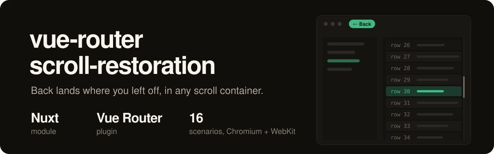
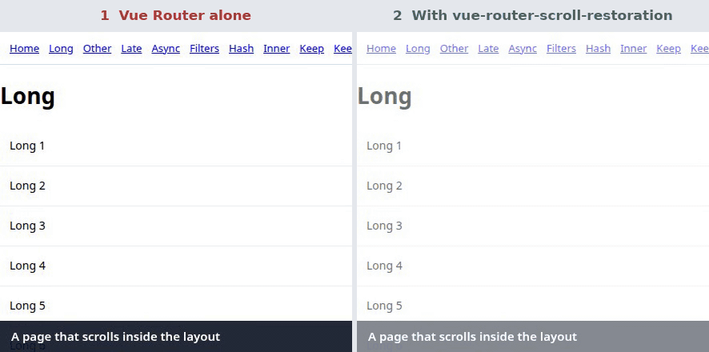
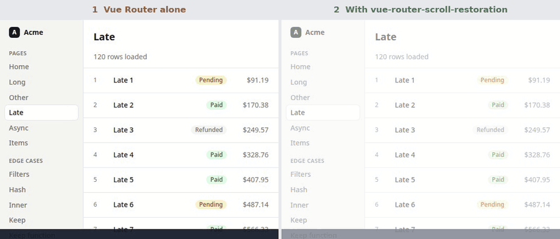

<p align="center">
  
</p>

<h1 align="center">Vue Router Scroll Restoration</h1>

<p align="center">Scroll restoration for Vue Router and Nuxt on any scroll container, not only <code>window</code>.</p>

<p align="center">
  <a href="https://npmx.dev/package/vue-router-scroll-restoration"></a>
  <a href="https://npmx.dev/package/vue-router-scroll-restoration"></a>
  <a href="https://npmx.dev/package/vue-router-scroll-restoration"></a>
</p>

Vue Router saves and restores the window's scroll position, and nothing else ([vuejs/vue-router#1187](https://github.com/vuejs/vue-router/issues/1187), open since 2017). Most dashboards don't scroll the window. They scroll a `<div>` next to the sidebar. So in a Vue or Nuxt dashboard:

- you scroll a list down to row 30 and open a row, and the next page opens halfway down
- you press Back, and the list is at the top again
- the list loads its rows after the page shows, so even a hand-written fix lands at the top, because the page wasn't tall enough yet



This package saves the position of every container you name, per history entry, and puts it back on Back, Forward and reload. It waits for the page to render, and keeps re-applying the position while late content loads, until the position holds or you scroll yourself.



## Quick start (Nuxt)

```sh
pnpm add vue-router-scroll-restoration
```

It needs `vue` 3.5 or newer and `vue-router` 4.2 or newer, including 5. The Nuxt module needs Nuxt 4.

```ts
// nuxt.config.ts
export default defineNuxtConfig({
  modules: ['vue-router-scroll-restoration/nuxt'],
  scrollRestoration: {
    containers: ['window', '[data-scroll-root]'],
  },
})
```

```vue
<!-- app/layouts/default.vue -->
<template>
  <div class="flex h-dvh">
    <AppSidebar />
    <main data-scroll-root class="flex-1 overflow-y-auto">
      <slot />
    </main>
  </div>
</template>
```

The module replaces Nuxt's `scrollBehavior`. It restores after `page:loading:end` and the page transition, the same moment Nuxt's own behaviour waits for. If your app has an `app/router.options.ts` that sets `scrollBehavior`, yours still wins.

Render nested pages with `<NuxtPage>`. It fires `page:loading:end`; a plain `<RouterView>` doesn't, so the restore would run too early.

## Vue without Nuxt

```ts
import { createRouter, createWebHistory } from 'vue-router'
import { setupScrollRestoration } from 'vue-router-scroll-restoration'

const router = createRouter({ history: createWebHistory(), routes })

setupScrollRestoration(router, {
  containers: ['window', '[data-scroll-root]'],
})
```

`setupScrollRestoration` replaces the router's `scrollBehavior`. You can call it before or after the first navigation.

## Features

- A new page starts at the top of the container, or at the `#hash` target inside it.
- Back and Forward restore the position each visit had, also after a reload.
- A navigation that only changes the query, like a filter, keeps the position.
- The position is re-applied while content loads, for up to 3 seconds.
- Scrolling, touching, clicking or typing stops a pending restore, and so does a new navigation.
- The window and any number of elements are tracked side by side.

## Options

| Option | Default | |
| --- | --- | --- |
| `containers` | `['window']` | Selectors of the elements that scroll. `'window'` is the document. |
| `settle` | `3000` | Keep re-applying a restored position while content loads, for at most this many milliseconds. `false` restores once. |
| `ready` | `nextTick` | Vue Router only. Resolves when the new page is on screen; the restore waits for it. |

### Containers inside a page

A container that a page renders, like a sidebar list or a panel, doesn't need to be in `containers`. Give it a `data-scroll-restoration-id` and it is tracked too:

```vue
<div data-scroll-restoration-id="sidebar" class="overflow-y-auto">…</div>
```

## Per route

```ts
definePageMeta({
  // leave the scroll alone when navigating to this page, as in Nuxt
  scrollToTop: false,
  // one saved position for every visit, links included, instead of one per history entry
  scrollKey: 'products',
})
```

With plain Vue Router, put both in the route's `meta`. `scrollToTop` can also be a function that returns `false`.

`scrollKey` is for overview pages. Without it, a position belongs to one history entry, so clicking an in-page "Back to products" link (a push, not a Back) opens the overview at the top. With a `scrollKey`, every visit to the overview shares one position. It is read from the matched leaf route only, so child routes don't inherit their parent's key.

## How it works

The package has three entries:

| Entry | What it does |
| --- | --- |
| `vue-router-scroll-restoration/core` | DOM only, no Vue. Finds containers, captures and restores positions, keeps them per key in memory and writes them to `sessionStorage` on `pagehide`. |
| `vue-router-scroll-restoration` | `setupScrollRestoration(router, options)` for Vue Router. |
| `vue-router-scroll-restoration/nuxt` | The Nuxt module. Sets up the plugin and waits for Nuxt's page and transition hooks. |

On every navigation the plugin captures all containers in `beforeEach`, while the old page is still on screen, under the key of the history entry you're leaving. Keys come from Vue Router's `history.state.position`, and the history listener tells a Back or Forward from a push. A push or replace starts at the top, a Back, Forward or reload restores.

To restore, the core sets each position and checks it again every frame. Content that loads late makes the page taller, so the position is applied again until it has held for 200 ms, the `settle` time runs out, or you take over with the wheel, a touch, a pointer or a key.

## Size and timings

Minified and gzipped with esbuild, `vue` and `vue-router` external:

| Entry | min | min+gzip |
| --- | --- | --- |
| `vue-router-scroll-restoration` | 2.9 kB | 1.4 kB |
| `vue-router-scroll-restoration/core` | 1.8 kB | 1.0 kB |
| `vue-router-scroll-restoration/nuxt` (client plugin) | 3.2 kB | 1.6 kB |

Medians of 15 runs in Chromium against the production playgrounds:

| | Vue Router | Nuxt |
| --- | --- | --- |
| Back restores the position, after `popstate` | 0.7 ms | 28 ms, after `page:loading:end` and a frame, as Nuxt's own `scrollBehavior` |
| Back to a table that renders 1.5 s later | 1505 ms | 1534 ms |
| Script time per navigation, with / without the package | 0.29 / 0.22 ms | |

## Compared with

Vue Router's and Nuxt's default `scrollBehavior` handle `window` only.

| | Inner containers | Back and Forward per history entry | Waits for late content | Nuxt | min+gzip |
| --- | --- | --- | --- | --- | --- |
| this package | yes | yes | yes, until it holds or `settle` ms | module | 1.4 kB |
| [`vue-router/experimental`](https://github.com/vuejs/router/blob/main/packages/docs/experimental/scroll-restoration.md) (5.4) | per component, with `capture` and `restore` | keyed by path and hash, so a push to a page you saw before restores its old position | no, restores once | no | +0.95 kB in `vue-router` |
| [`vue-router-better-scroller`](https://github.com/antfu/vue-router-better-scroller) | yes | saves only when leaving by link, so Forward lands at the top | no, restores once after `nextTick` | no | 0.9 kB |
| [`nuxt-scroll-restoration`](https://github.com/shimizukawa/nuxt-scroll-restoration) | window only | yes, by patching `history.pushState` | retries for 3 s | Nuxt 3 module | 2.2 kB |

[SPEC.md](./SPEC.md) has the full research, the 16 scenarios the tests cover, and what isn't built yet.

## Not supported

- Horizontal scrolling inside grids
- Virtual lists that need an item index instead of a pixel offset
- Restoring before hydration on reload. The position comes back once the app has mounted.

## Develop

```sh
pnpm install
pnpm dev:prepare   # stub the module and generate types
pnpm dev           # Nuxt playground on :4310
pnpm dev:vue       # Vue Router playground on :4311
pnpm lint
pnpm typecheck
pnpm test:e2e      # the 16 scenarios on both playgrounds, Chromium and WebKit
```

## Release

Releases are cut by [uppt](https://github.com/danielroe/uppt) from [conventional commits](https://www.conventionalcommits.org). Every push to `main` opens or updates a draft release PR with the next version and changelog. Merging it tags the release and publishes to npm with provenance.

## License

[MIT](./LICENSE)
